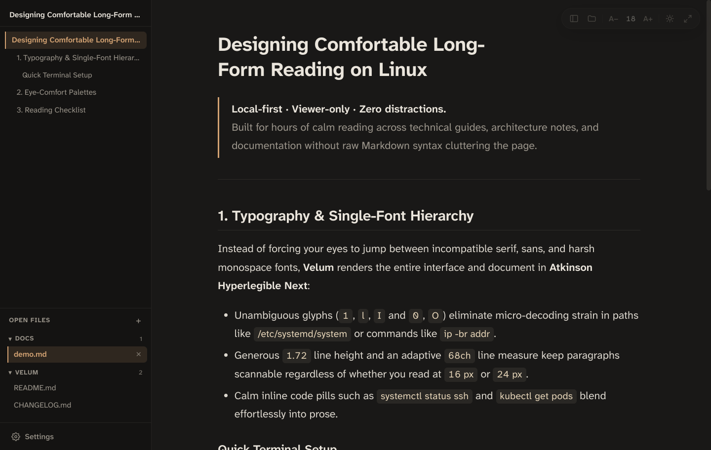
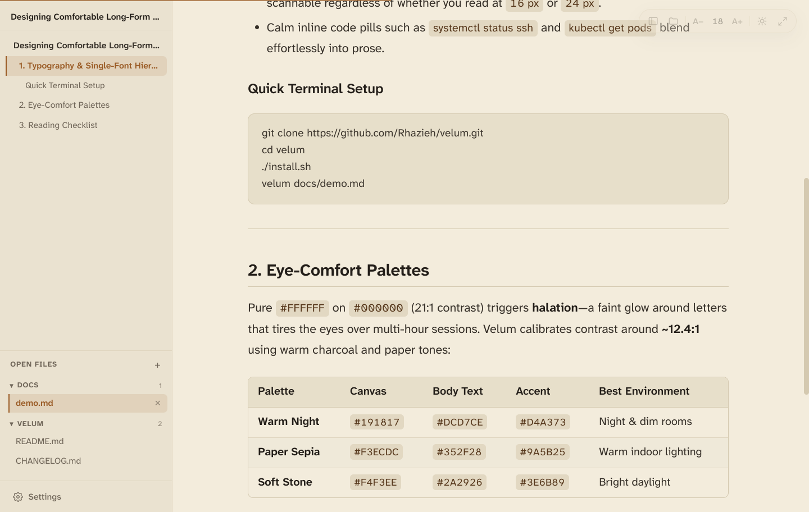

<p align="center">
  
</p>

<h1 align="center">Velum</h1>

<p align="center">
  <strong>Visor de Markdown rápido, minimalista y 100% local, diseñado para leer durante horas sin fatiga visual en Linux.</strong>
</p>

<p align="center">
  <a href="https://github.com/Rhazieh/velum/actions/workflows/ci.yml"></a>
  <a href="LICENSE"></a>
  
  
  
</p>

<p align="center">
  <a href="README.md">English</a> &nbsp;|&nbsp; <strong>Español</strong>
</p>

---

## ¿Por qué Velum?

Casi todas las aplicaciones para abrir Markdown en Linux o en la web son **editores primero**: dividen la pantalla mostrando el código `**crudo**` junto a la vista previa, no permiten pantalla completa limpia, cobran suscripciones por funciones básicas o te obligan a subir archivos locales privados a servidores de terceros.

Solo quería hacer doble clic en un `.md` y **leerlo limpio, rápido y sin conexión**, sin ver código fuente ni cansar la vista después de horas estudiando apuntes o documentación técnica.

Velum nació para resolver exactamente ese problema mediante un **flujo de desarrollo asistido por IA**, combinando criterios concretos de ergonomía tipográfica, calibración de contraste anti-halación e integración nativa con Linux Wayland/X11 y Freedesktop.

---

## Capturas de pantalla

| Noche cálida (`warm-dark`, predeterminada) | Sepia papel (`sepia`) |
| :---: | :---: |
|  |  |

---

## Diseño ergonómico y comodidad visual

- **Una sola fuente en toda la app:** Toda la interfaz y el documento usan exclusivamente [**Atkinson Hyperlegible Next**](https://github.com/googlefonts/atkinson-hyperlegible-next) (Braille Institute), incluida localmente bajo licencia SIL OFL 1.1. Su diferenciación extrema entre glifos ambiguos (`1`/`l`/`I`, `0`/`O`), altura x amplia y aperturas abiertas reduce el cansancio mental al leer texto largo mezclado con rutas y comandos (`Noto Color Emoji` solo actúa como respaldo para emojis).
- **Contraste calibrado contra la halación:** El blanco puro `#FFFFFF` sobre negro `#000000` (`21:1`) produce halo luminoso y fatiga visual. Velum usa por defecto **Noche cálida** (`#DCD7CE` sobre `#191817`, contraste `~12.4:1` WCAG AAA) con acentos ámbar cálidos (`#D4A373`) evitando el azul saturado.
- **Tres paletas con un atajo (`Ctrl+T`):**

  | Paleta | Fondo | Texto | Acento | Ideal para |
  | :--- | :--- | :--- | :--- | :--- |
  | **Noche cálida** (`warm-dark`) | `#191817` | `#DCD7CE` | `#D4A373` | Noche y ambientes con poca luz |
  | **Sepia papel** (`sepia`) | `#F3ECDC` | `#352F28` | `#9A5B25` | Luz interior cálida |
  | **Piedra suave** (`soft-light`) | `#F4F3EE` | `#2A2926` | `#3E6B89` | Luz diurna intensa |

- **Medida y escala óptimas:** Ancho adaptable de `68ch` (`~65–72` caracteres por línea en cualquier tamaño), interlineado `1.72` y tamaño de texto persistente de `12` a `36 px` (`Ctrl++` / `Ctrl+-` / `Ctrl + rueda`).
- **Cero ruido visual:** Sin barras de menú ni editor; índice lateral colapsable con *scrollspy* (se oculta automáticamente si el archivo tiene menos de 2 encabezados), línea superior de progreso de `2 px` y controles flotantes discretos.

---

## Compatibilidad en Linux

Velum funciona de forma nativa en **Wayland y X11** (Qt6 selecciona `wayland` o `xcb` automáticamente según la sesión):

- **Servidores gráficos:** Wayland (`wayland-egl`) y X11 (`xcb`).
- **Entornos y gestores de ventanas:** KDE Plasma 6/5, GNOME, Hyprland, Sway, XFCE, Cinnamon, LXQt y cualquier entorno compatible con estándares Freedesktop (`XDG_DATA_HOME`, `XDG_CONFIG_HOME`, `xdg-mime`).
- **Idioma de la interfaz:** Detecta automáticamente español o inglés desde la configuración regional del sistema (editable con `"language": "es"` o `"en"` en `~/.config/velum/settings.json`).

---

## Instalación

### 1. Dependencias del sistema

Instalá PyQt6 WebEngine y la librería en C `libcmark-gfm` (o `python3-markdown` como respaldo):

- **Debian / Ubuntu (Debian 12/13, Ubuntu 24.04+):**
  ```bash
  sudo apt install python3-pyqt6 python3-pyqt6.qtwebengine python3-pyqt6.qtwebchannel cmark-gfm
  ```
- **Fedora:**
  ```bash
  sudo dnf install python3-pyqt6 python3-pyqt6-webengine cmark-gfm-libs
  ```
- **Arch Linux:**
  ```bash
  sudo pacman -S python-pyqt6 python-pyqt6-webengine cmark-gfm
  ```

### 2. Instalar Velum (por usuario, sin `sudo`)

```bash
git clone https://github.com/Rhazieh/velum.git
cd velum
./install.sh
```

Si querés instalarlo sin asignarlo como programa predeterminado para `.md`:

```bash
./install.sh --no-default
```

### Desinstalar

```bash
./uninstall.sh          # conserva ~/.config/velum/settings.json
./uninstall.sh --purge  # elimina también la configuración
```

---

## Uso y atajos de teclado

Abrilo desde el menú de aplicaciones, haciendo doble clic en cualquier `.md` desde Dolphin/Archivos, arrastrando el archivo a la ventana o desde terminal:

```bash
velum ruta/al/archivo.md  # abre el archivo (reutiliza la instancia activa vía IPC)
velum                     # abre la pantalla de inicio con recientes
velum --standalone f.md   # fuerza un proceso independiente
velum --version           # muestra la versión
```

| Atajo | Acción |
| :--- | :--- |
| `Ctrl+O` | Abrir selector de archivos |
| `Ctrl++` / `Ctrl+-` / `Ctrl+0` | Aumentar / reducir / restablecer tamaño (`18 px`) |
| `Ctrl + Rueda` | Ajustar tamaño de texto suavemente |
| `Ctrl+T` | Cambiar paleta (`Noche cálida` → `Sepia papel` → `Piedra suave`) |
| `Ctrl+B` | Mostrar u ocultar índice lateral |
| `Ctrl+F` | Buscar dentro del texto (`Enter` / `Shift+Enter`, `Esc` cierra) |
| `j` / `k` | Desplazamiento vertical suave |
| `F11` | Pantalla completa |
| `Alt+←` / `Alt+→` (o botones laterales del mouse) | Navegar entre `.md` locales enlazados |
| `Ctrl+R` / `F5` | Recargar manualmente (también recarga sola al guardar cambios) |
| `Ctrl+W` / `Ctrl+Q` | Cerrar ventana / salir |

---

## Arquitectura y seguridad

- **Renderizado veloz:** Invoca directamente a `libcmark-gfm` del sistema mediante `ctypes` (~11–13 ms en documentos de más de 5.000 palabras), con respaldo automático en `python-markdown`.
- **Sanitización y CSP estricta:** Filtra `<script>`, `<iframe>`, `<object>`, `<embed>`, manejadores `on*` y URIs `javascript:` / `data:` inseguros antes de insertar en el DOM; aplica `Content-Security-Policy` estricta sin scripts en línea.
- **Arranque sin parpadeo blanco y recarga en vivo:** Configura el color de fondo en `QMainWindow` y `QWebEnginePage` antes de cargar el HTML, monitorea cambios con `QFileSystemWatcher` (preservando la posición de lectura incluso ante guardados atómicos) y usa un socket local `QLocalServer` para abrir nuevas ventanas al instante.

---

## Parte de una suite local para Linux

Velum es la primera herramienta de una colección personal de utilidades Linux de código abierto, livianas y sin dependencia de terceros o servicios en la nube — con un lector minimalista de EPUB como próximo proyecto planeado.

---

## Licencia y agradecimientos

- **Código:** [Licencia MIT](LICENSE) — Copyright © 2026 Maximiliano Cano (`Rhazieh`).
- **Fuente incluida:** [Atkinson Hyperlegible Next](https://github.com/googlefonts/atkinson-hyperlegible-next) bajo licencia [SIL Open Font License 1.1](THIRD_PARTY_LICENSES/OFL-1.1.txt).
