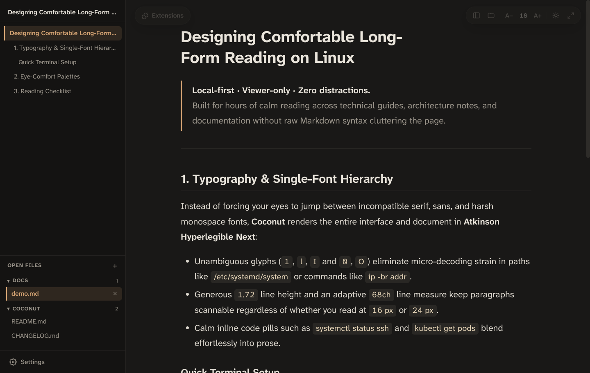
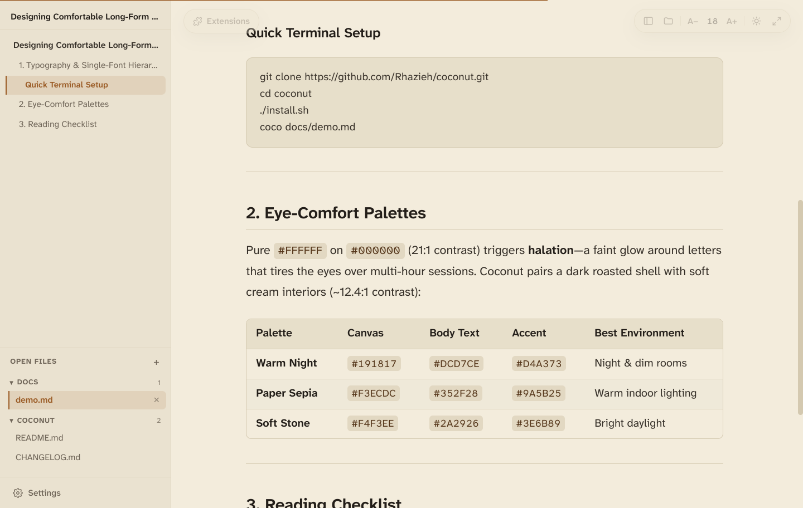

<p align="center">
  
</p>

<h1 align="center">Coconut</h1>

<p align="center">
  <strong>A fast, minimalist, local-first Markdown viewer engineered for hours of comfortable reading on Linux.</strong>
</p>

<p align="center">
  <a href="https://github.com/Rhazieh/coconut/actions/workflows/ci.yml"></a>
  <a href="LICENSE"></a>
  
  
  
</p>

<p align="center">
  <strong>English</strong> &nbsp;|&nbsp; <a href="README.es.md">Español</a>
</p>

---

## Why Coconut (`coco`)?

Most Markdown apps on Linux or the web are built as **editors first**—splitting your screen between raw `**syntax**` and preview, locking clean reading layouts behind subscriptions, refusing distraction-free fullscreen, or asking you to paste private local notes into third-party websites.

I just wanted to double-click a `.md` file (or run `coco notes.md`) and **read it cleanly, fast, and completely offline**, without seeing raw code or sacrificing my eyes after hours of studying technical documentation.

Like a real coconut—**warm dark roasted shell on the outside (`#191817`), soft cream interior on the inside (`#DCD7CE` / `#F3ECDC`)**—it was built through an **AI-assisted development workflow** paired with deliberate ergonomic research, anti-halation contrast calibration, and native Freedesktop/Wayland integration.

---

## Screenshots

| Warm Night (`warm-dark`, default) | Paper Sepia (`sepia`) |
| :---: | :---: |
|  |  |

---

## Ergonomic Design & Eye Comfort

- **One Typeface Everywhere:** Entire UI and prose use [**Atkinson Hyperlegible Next**](https://github.com/googlefonts/atkinson-hyperlegible-next) (Braille Institute), bundled locally under SIL OFL 1.1. Distinct glyph forms (`1`/`l`/`I`, `0`/`O`), large x-height, and open apertures eliminate micro-decoding fatigue across prose, tables, file paths, and terminal commands (`Noto Color Emoji` handles emoji glyphs only).
- **Anti-Halation Contrast Calibration:** Pure `#FFFFFF` on `#000000` (`21:1`) causes light scatter (*halation*) and eye strain. Coconut defaults to **Warm Night** (`#DCD7CE` on `#191817`, `~12.4:1` WCAG AAA contrast) with toasted amber accents (`#D4A373`) to avoid harsh blue-light glare.
- **Three Instant Palettes (`Ctrl+T`):**

  | Palette | Canvas | Body Text | Accent | Best For |
  | :--- | :--- | :--- | :--- | :--- |
  | **Warm Night** (`warm-dark`) | `#191817` | `#DCD7CE` | `#D4A373` | Night & dim rooms (default) |
  | **Paper Sepia** (`sepia`) | `#F3ECDC` | `#352F28` | `#9A5B25` | Warm indoor lighting |
  | **Soft Stone** (`soft-light`) | `#F4F3EE` | `#2A2926` | `#3E6B89` | Bright daylight |

- **Optimal Measure & Scaling:** Adaptive `68ch` line width (`~65–72` characters per line at any size), `1.72` line height, and persistent `12–36 px` text sizing (`Ctrl++` / `Ctrl+-` / `Ctrl+Wheel`).
- **Zero Chrome Clutter & Multi-File Sidebar:** No menus, no toolbars, no split editor—just a collapsible left sidebar combining the scrollspy **Outline** (auto-hidden on short docs), **collapsible folder groups** for all open `.md` files (persisted across restarts like a notepad until manually closed), and a subtle bottom-left **Settings** gear (`Ctrl+,`).
- **Right-Click Google Translate:** Select any word or passage while reading, right-click, and open it pre-filled in Google Translate using your configured language pair (`Auto → ES`, `EN → ES`, `ES → EN`, or 27 common languages—strictly on-click, zero background network calls).
- **Fullscreen, Extensions & Customizable Shortcuts:** Dedicated top-right fullscreen button (`F11`), live shortcut editor in Settings, and a symmetrical top-left **Extensions** pill preparing Coconut for optional, lightweight text-only language modules (`.txt`, `.epub`, `.js`, `.ts`, `.java`, `.html`, etc.) installed on demand without compiler/IDE bloat.

---

## Linux Compatibility

Coconut targets **modern Linux desktops on both Wayland and X11** (Qt6 selects `wayland` or `xcb` automatically based on your session):

- **Display Servers:** Native Wayland (`wayland-egl`) & X11 (`xcb`).
- **Desktop Environments & WMs:** KDE Plasma 6/5, GNOME, Hyprland, Sway, XFCE, Cinnamon, LXQt, and any Freedesktop-compliant environment (`XDG_DATA_HOME`, `XDG_CONFIG_HOME`, `xdg-mime`).
- **Interface Language:** Automatically matches English or Spanish from your system locale (or switch live anytime in Settings / `~/.config/coconut/settings.json`).

---

## Installation

### 1. System Dependencies

Install PyQt6 WebEngine and the C `libcmark-gfm` library (or `python3-markdown` fallback):

- **Debian / Ubuntu (Debian 12/13, Ubuntu 24.04+):**
  ```bash
  sudo apt install python3-pyqt6 python3-pyqt6.qtwebengine python3-pyqt6.qtwebchannel cmark-gfm
  ```
- **Fedora:**
  ```bash
  sudo dnf install python3-pyqt6 python3-pyqt6-webengine cmark-gfm-libs
  ```
- **Arch Linux:**
  ```bash
  sudo pacman -S python-pyqt6 python-pyqt6-webengine cmark-gfm
  ```

### 2. Install Coconut

**Option A — Debian / Ubuntu `.deb` package (from [Releases](https://github.com/Rhazieh/coconut/releases)):**

```bash
sudo apt install ./coconut_1.3.0_all.deb
```

**Option B — User-local install from source (no `sudo` required):**

```bash
git clone https://github.com/Rhazieh/coconut.git
cd coconut
./install.sh
```

This installs the `coco` command (plus `coconut` alias) and sets Coconut as the default `.md` viewer. To install without changing your default `.md` file handler:

```bash
./install.sh --no-default
```

Package maintainers can also build a `.deb` locally via `./packaging/build-deb.sh` or use `packaging/aur/PKGBUILD` on Arch Linux.

### Uninstall

```bash
./uninstall.sh          # keeps ~/.config/coconut/settings.json
./uninstall.sh --purge  # removes settings too
```

---

## Usage & Shortcuts

Launch from your application menu (**Coconut**), double-click any `.md` file in Dolphin/Files, drag files onto the window, or run from terminal:

```bash
coco path/to/notes.md     # open a file (reuses running process via fast IPC)
coco                      # open welcome screen or restore previous session
coco --standalone f.md    # force a separate process
coco --version            # print version
```

| Shortcut *(editable)* | Action |
| :--- | :--- |
| `Ctrl+O` | Open files (multi-select) |
| `Ctrl++` / `Ctrl+-` / `Ctrl+0` | Increase / decrease / reset text size (`18 px`) |
| `Ctrl + Wheel` | Smoothly scale text size |
| `Ctrl+T` | Cycle color palette (`Warm Night` → `Paper Sepia` → `Soft Stone`) |
| `Ctrl+B` | Toggle outline & open-files sidebar |
| `Ctrl+F` | Find in document (`Enter` / `Shift+Enter`, `Esc` to close) |
| `Ctrl+,` | Open Settings (toggles, Google Translate pair, shortcuts, credits) |
| `j` / `k` | Gentle vertical scroll |
| `F11` (or top-right button) | Fullscreen reading mode |
| `Ctrl+Tab` / `Ctrl+Shift+Tab` | Switch to next / previous open file |
| `Alt+←` / `Alt+→` (or Mouse Back/Forward) | Navigate between linked local `.md` files |
| `Ctrl+R` / `F5` | Manual reload (also auto-reloads on disk edits) |
| `Ctrl+W` / `Ctrl+Q` | Close current file / quit (preserving session) |

---

## Architecture & Security

- **Fast Rendering:** Calls system `libcmark-gfm` directly via Python `ctypes` (~11–13 ms for 5,000+ words) with automatic `python-markdown` fallback.
- **Sanitized & Strict CSP:** Strips `<script>`, `<iframe>`, `<object>`, `<embed>`, `<svg>`, event handlers (`on*`), and `javascript:` / unsafe `data:` URIs before injecting into the DOM; enforces a strict `Content-Security-Policy` with zero inline scripts.
- **Zero-Flash Startup & Live Reload:** Applies background color on both `QMainWindow` and `QWebEnginePage` before loading the DOM, watches the active file via `QFileSystemWatcher` (handling atomic editor saves while preserving scroll position), and routes new launches through a per-user `QLocalServer` Unix socket.

---

## Modular Extensions Roadmap

Coconut stays strictly **viewer-only and lightweight** (never a heavy IDE or compiler host). Future updates will let you opt in to optional, text-focused extensions right from the **Extensions** button—such as calm syntax highlighting for `.js`, `.ts`, `.java`, `.html`, or plain-reading modules like `.txt` and `.epub`—installed individually with an **Add** button only when you actually need them.

---

## License & Acknowledgments

- **Code:** [MIT License](LICENSE) — Copyright © 2026 Maximiliano Cano (`Rhazieh`).
- **Bundled Font:** [Atkinson Hyperlegible Next](https://github.com/googlefonts/atkinson-hyperlegible-next) licensed under the [SIL Open Font License 1.1](THIRD_PARTY_LICENSES/OFL-1.1.txt).
